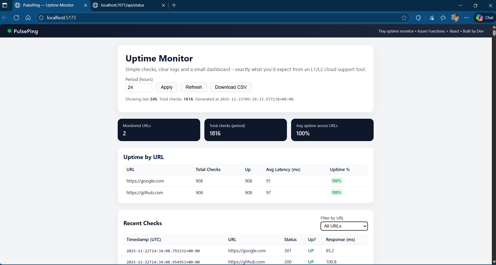
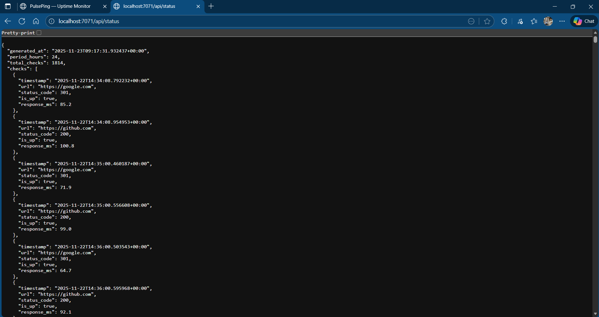

# PulsePing — Serverless Uptime Monitor + Dashboard

**Live dashboard:** https://proud-water-09cf8e200.6.azurestaticapps.net
**Status API:** https://pulseping-func-dev31.azurewebsites.net/api/status

> To keep hosting cost at ₹0, the backend is switched **off** between demos. If the dashboard says it can't reach the API, the monitor is simply paused — see [Operating it](#operating-it-on-off-at-zero-cost).


[]()
[]()
[]()
[]()
[](LICENSE)

**PulsePing** is a small serverless uptime monitor I built to practise:

- Azure Functions (Timer + HTTP trigger)
- Azure Blob Storage (via Azurite locally)
- Python + `httpx`
- React + a simple dashboard for non-technical users

The idea is simple:

> A timer function pings a list of URLs, logs to Blob Storage,  
> an HTTP function exposes the last 24h as JSON,  
> and a small React UI shows uptime %, recent checks, and CSV export.

---

## 🔍 Screenshots

### Dashboard (React UI)



### Status API (JSON response)



---

## 1. Tech Stack

### Backend

- ⚡ **Azure Functions v4** on the **Flex Consumption** plan (Python v2 programming model)
  - Timer trigger: `ping_timer` (hourly)
  - HTTP trigger: `get_status`
- 🐍 **Python**
  - `httpx` for HTTP requests
  - `azure-storage-blob` for Blob Storage
- 🗄️ **Azure Blob Storage**
  - In local dev: [Azurite](https://github.com/Azure/Azurite) emulator

### Frontend

- ⚛️ **React 18** (Vite), hosted on **Azure Static Web Apps (Free)**
- Fetch API
- Simple custom CSS (no UI library)

---

## 2. What PulsePing Actually Does

**Backend flow:**

1. **Timer trigger** (`ping_timer`)
   - Runs hourly (`0 0 * * * *`).
   - Reads URLs from `PULSEPING_URLS` (comma-separated).
   - Uses `httpx` to ping each URL.
   - Logs each check as one JSON line:

     ```json
     {
       "timestamp": "2025-11-22T14:34:08.792232+00:00",
       "url": "https://google.com",
       "status_code": 301,
       "is_up": true,
       "response_ms": 85.2
     }
     ```

   - Appends to a daily blob:  
     `pulseping-logs/pings-YYYY-MM-DD.jsonl`

2. **HTTP trigger** (`get_status`)
   - Accepts a query parameter: `hours` (default: `24`)
   - Reads blob(s) for the last N hours, parses JSON lines.
   - Returns a JSON payload:

     ```json
     {
       "generated_at": "2025-11-22T14:46:12.722044+00:00",
       "period_hours": 24,
       "total_checks": 26,
       "checks": [ /* array of log entries */ ]
     }
     ```

**Frontend flow:**

- Calls `GET /api/status?hours=24` from the Functions backend.
- Shows:
  - **Summary cards**: monitored URLs, total checks, average uptime.
  - **Uptime by URL**: total checks, up count, avg latency, uptime % with coloured badges.
  - **Recent checks**: timestamp, URL, HTTP status, UP/DOWN, response time.
  - **Filter by URL** (for the checks table).
- “**Download CSV**” button:
  - Converts current `checks` into `pulseping-<hours>h-export.csv`
  - Designed so someone in support/ops can attach it to tickets.

This is intentionally more “L1/L2 cloud support tool” than “fancy SRE platform”.

---

## 3. Repo Structure

```text
pulseping-uptime-monitor/
├── README.md
├── LICENSE
├── .gitignore
├── docs/
│   ├── pulseping-dashboard.png          # React UI screenshot
│   └── pulseping-status-endpoint.png    # /api/status JSON screenshot
├── dashboard/                  # React dashboard (Vite)
│   ├── index.html
│   ├── package.json
│   ├── package-lock.json
│   ├── vite.config.js
│   └── src/
│       ├── main.jsx
│       ├── App.jsx
│       └── styles.css
└── functions/                  # Azure Functions backend (Python)
    ├── host.json
    ├── local.settings.example.json
    ├── requirements.txt
    ├── shared/
    │   ├── __init__.py
    │   ├── config.py           # config & URL helpers
    │   └── storage.py          # Blob read/write helpers
    ├── function_app.py         # ping_timer (timer) + get_status (HTTP), v2 model
    └── .funcignore
```
        
## 4. Running the Backend (Functions + Azurite)

4.1 Prereqs

- Python 3.10+
- Node.js + npm
- Azure Functions Core Tools v4 (func)
- Azurite

4.2 Start Azurite

- Install (once):
```
npm install -g azurite
```
- Run in a separate terminal:
```
azurite --silent --location C:\azurite --debug C:\azurite\debug.log
```
- Azurite endpoints (default):
Blob: http://127.0.0.1:10000/devstoreaccount1
Keep this process running.


4.3 local.settings.json (local-only):

Inside functions/, create local.settings.json
```
{
  "IsEncrypted": false,
  "Values": {
    "AzureWebJobsStorage": "DefaultEndpointsProtocol=http;AccountName=devstoreaccount1;AccountKey=Eby8vdM02xNOcqFlqUwJPLlmEtlCDXJ1OUzFT50uSRZ6IFsuFq2UVErCz4I6tq/K1SZFPTOtr/KBHBeksoGMGw==;BlobEndpoint=http://127.0.0.1:10000/devstoreaccount1;",
    "FUNCTIONS_WORKER_RUNTIME": "python",

    "PULSEPING_STORAGE_CONNECTION": "DefaultEndpointsProtocol=http;AccountName=devstoreaccount1;AccountKey=Eby8vdM02xNOcqFlqUwJPLlmEtlCDXJ1OUzFT50uSRZ6IFsuFq2UVErCz4I6tq/K1SZFPTOtr/KBHBeksoGMGw==;BlobEndpoint=http://127.0.0.1:10000/devstoreaccount1;",
    "PULSEPING_CONTAINER_NAME": "pulseping-logs",

    "PULSEPING_URLS": "https://google.com,https://github.com",
    "PULSEPING_ALLOWED_ORIGINS": "http://localhost:5173"
  }
}
```

- Change PULSEPING_URLS to whatever you want to monitor.
- In a real Azure deployment, these would be real connection strings in App Settings.

4.4 Start Functions locally:
```
cd functions

python -m venv .venv

# Windows
.venv\Scripts\activate
# macOS / Linux
# source .venv/bin/activate

pip install -r requirements.txt

func start
```

Now:

- HTTP API: http://localhost:7071/api/status
- Timer trigger will start writing blobs to Azurite (pulseping-logs container).
```
curl http://localhost:7071/api/status
```

## 5. Running the React Dashboard
```
cd dashboard
npm install
npm run dev
```
Open:
```
http://localhost:5173
```
The dashboard reads the backend URL from `VITE_API_BASE_URL` at build time and falls back to `http://localhost:7071` for local development. For a deployed build:
```
VITE_API_BASE_URL=https://<your-function-app>.azurewebsites.net npm run build
```
(see `dashboard/.env.example`).

## 6. Deployment (live)

```text
Browser ──HTTPS──▶ Azure Static Web Apps (Free, East Asia)        React dashboard
   │
   └──HTTPS──▶ Azure Functions, Flex Consumption (Central India)  GET /api/status
                     │   ▲
          hourly timer│   │ reads last 24h
                     ▼   │
               Azure Blob Storage (Standard LRS)                  pings-YYYY-MM-DD.jsonl
```

| Resource | Name | Notes |
|---|---|---|
| Resource group | `rg-pulseping` | Central India |
| Function app | `pulseping-func-dev31` | Flex Consumption, Python 3.11, 512 MB instances, no Application Insights |
| Storage account | `stpulseping…` | Functions host storage + ping logs; HTTPS/TLS 1.2 only, no public blob access |
| Static Web App | `pulseping-dashboard` | Free tier |

**App settings:** `PULSEPING_STORAGE_CONNECTION`, `PULSEPING_URLS`, `PULSEPING_ALLOWED_ORIGINS` (set to the dashboard origin so only it can call the API from a browser).

**Deploy the backend** (remote build installs `requirements.txt` in Azure):
```bash
cd functions
zip -r ../pulseping-func.zip . -x ".venv/*" "*__pycache__*" "local.settings.json"
az functionapp deployment source config-zip -g rg-pulseping -n pulseping-func-dev31 \
  --src ../pulseping-func.zip --build-remote true
```

**Deploy the dashboard:**
```bash
cd dashboard
npm ci
VITE_API_BASE_URL=https://pulseping-func-dev31.azurewebsites.net npm run build
npx @azure/static-web-apps-cli deploy ./dist --deployment-token <token> --env production
```

### Operating it (on/off at zero cost)

PulsePing is a demo, so the backend only runs when it's being shown:

| State | What runs | Cost |
|---|---|---|
| Off (`az functionapp stop`) | Nothing — no timer runs, no storage transactions | ~₹0 (a few MB of stored data) |
| On (`az functionapp start`) | Hourly checks + API | Within the Flex Consumption free grant |
| Dashboard | Static files on SWA Free | ₹0 always |

```bash
az functionapp start -g rg-pulseping -n pulseping-func-dev31   # before a demo
az functionapp stop  -g rg-pulseping -n pulseping-func-dev31   # after
```

Run an immediate check instead of waiting for the hourly timer:
```bash
KEY=$(az functionapp keys list -g rg-pulseping -n pulseping-func-dev31 --query masterKey -o tsv)
curl -X POST "https://pulseping-func-dev31.azurewebsites.net/admin/functions/ping_timer" \
  -H "x-functions-key: $KEY" -H "Content-Type: application/json" -d '{"input":""}'
```

### Design decisions

- **Flex Consumption** — pay-per-execution with a monthly free grant; the older Linux Consumption plan retires in September 2028.
- **Hourly schedule** — enough history for a 24h uptime view while keeping storage transactions minimal.
- **Python v2 programming model** — one `function_app.py` with decorators instead of per-function `function.json` folders.
- **No Application Insights** — avoids a separately billed telemetry service for a demo workload.
- **CORS locked to the dashboard origin** — the API is public for reads but browsers only allow the dashboard to use it.

## 7. License
This project is licensed under the MIT License.
See LICENSE for details.


